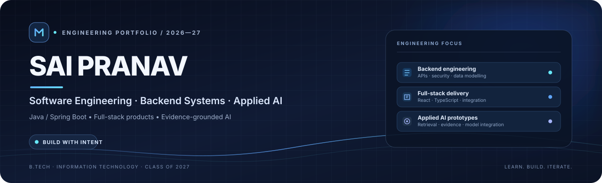
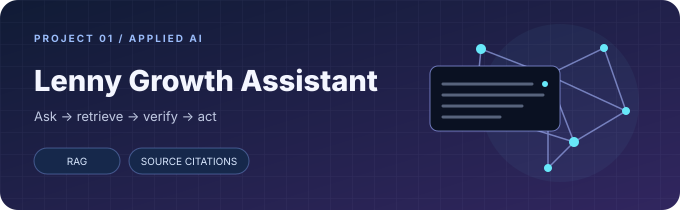
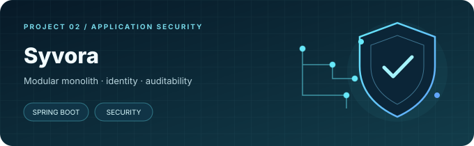
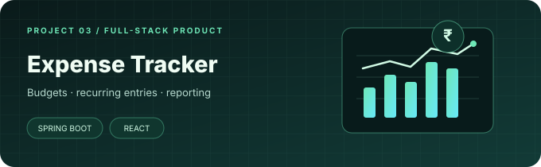
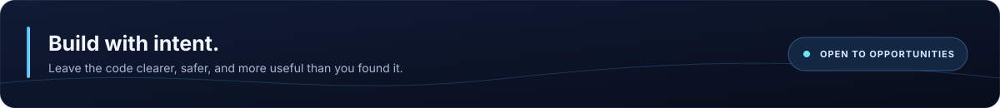

  

  
  
  
  

  <strong>Backend-first engineering</strong> &nbsp;·&nbsp; <strong>Thoughtful product delivery</strong> &nbsp;·&nbsp; <strong>Evidence-grounded AI</strong>

OPEN TO GRADUATE ROLES & INTERNSHIPS · SOFTWARE ENGINEERING · JAVA BACKEND · FULL-STACK · FORWARD DEPLOYED ENGINEERING

  

## 01 &nbsp; PROFILE

I'm **Sai Pranav**, a final-year B.Tech Information Technology student at **Dr. N.G.P. Institute of Technology**, graduating in 2027. I enjoy turning problem statements into working software—especially backend services, secure application workflows, and full-stack products that are clear to use and maintain.

My primary engineering focus is **Java, Spring Boot, REST API design, authentication and authorization, relational databases, and practical testing**. I also build with React and TypeScript, and have explored retrieval-augmented generation (RAG) through an evidence-grounded AI prototype.

<table>
  <tr>
    <td width="33%" valign="top">
      <strong>ENGINEERING</strong> 
      Java · Spring Boot · REST APIs 
      Backend design and application logic
    </td>
    <td width="33%" valign="top">
      <strong>PRODUCT DELIVERY</strong> 
      React · TypeScript · PostgreSQL 
      Frontend-to-backend integration
    </td>
    <td width="34%" valign="top">
      <strong>PROBLEM SOLVING</strong> 
      550+ LeetCode problems 
      DSA, edge cases, and algorithmic thinking
    </td>
  </tr>
</table>

  

## 02 &nbsp; SELECTED WORK

PROJECT SPOTLIGHTS · PROTOTYPES AND ACADEMIC/PERSONAL BUILDS

<table>
  <tr>
    <td width="33.33%" valign="top">
      
      <h3>Lenny Growth Assistant</h3>
      
<strong>Evidence-grounded AI workspace</strong>

      
A prototype that retrieves relevant podcast transcript passages and uses them as evidence for product and growth answers.

      
RAG · PostgreSQL full-text search · source-linked citations · saved sessions

      
<code>React</code> <code>TypeScript</code> <code>FastAPI</code> <code>Python</code> <code>PostgreSQL</code>

      
<a href="https://github.com/saipranav22-commits/lenny-growth-assistant"><strong>VIEW REPOSITORY ↗</strong></a>

    </td>
    <td width="33.33%" valign="top">
      
      <h3>Syvora</h3>
      
<strong>Zero Trust security platform</strong>

      
A modular Spring Boot application focused on authentication, role-based access, threat-monitoring workflows, and security auditability.

      
Modular monolith · REST APIs · security controls · audit workflows

      
<code>Java 21</code> <code>Spring Boot</code> <code>Spring Security</code> <code>React</code> <code>PostgreSQL</code>

      
<a href="https://github.com/saipranav22-commits/zero-trust-platform"><strong>VIEW REPOSITORY ↗</strong></a>

    </td>
    <td width="33.33%" valign="top">
      
      <h3>Expense Tracker</h3>
      
<strong>Personal finance full-stack app</strong>

      
A finance workflow for tracking spending, organizing categories, setting budgets, scheduling recurring entries, and reviewing reports.

      
JWT authentication · recurring transactions · analytics · CSV/PDF exports

      
<code>Java</code> <code>Spring Boot</code> <code>React</code> <code>PostgreSQL</code>

      
<a href="https://github.com/saipranav22-commits/expense-tracker"><strong>VIEW REPOSITORY ↗</strong></a>

    </td>
  </tr>
</table>

### More projects

- **[User Authentication System](https://github.com/saipranav22-commits/user-authentication-system)** — a Java/Spring Security authentication project focused on password hashing, JWT-based authentication, and role-based authorization.
- **[Portfolio](https://github.com/saipranav22-commits/portfolio)** — my personal portfolio website and source code.
- **[All repositories →](https://github.com/saipranav22-commits?tab=repositories)** — additional academic, full-stack, and exploratory projects.

Project artwork above is custom illustrative cover art, not a screenshot of a running application. Check each repository for implementation details, setup steps, and current project status.

  

## 03 &nbsp; TECHNICAL TOOLKIT

  

<table>
  <tr>
    <td width="50%" valign="top">
      <strong>LANGUAGES</strong> 
      Java · Python · JavaScript · TypeScript · SQL
        
      <strong>BACKEND</strong> 
      Spring Boot · Spring Security · REST APIs · FastAPI · JWT
    </td>
    <td width="50%" valign="top">
      <strong>FRONTEND</strong> 
      React · HTML · CSS · TypeScript
        
      <strong>DATA & TOOLING</strong> 
      PostgreSQL · MySQL · MongoDB · Git · GitHub · Docker
    </td>
  </tr>
</table>

**Applied AI:** RAG workflows, transcript retrieval, source-grounded responses, and integration with existing model runtimes. My work here is application-level prototyping—not training foundation models.

  

## 04 &nbsp; HOW I APPROACH ENGINEERING

<table>
  <tr><td width="25%"><strong>01 · Understand</strong></td><td>Clarify the user problem, constraints, and expected outcome before choosing an implementation.</td></tr>
  <tr><td><strong>02 · Design</strong></td><td>Model the data, define API boundaries, and separate responsibilities into maintainable components.</td></tr>
  <tr><td><strong>03 · Build</strong></td><td>Implement the smallest useful end-to-end workflow, with validation, authentication, and clear error handling where needed.</td></tr>
  <tr><td><strong>04 · Verify</strong></td><td>Exercise normal paths, edge cases, and failure paths; use evidence rather than assumptions to judge whether a fix works.</td></tr>
  <tr><td><strong>05 · Communicate</strong></td><td>Document setup, explain trade-offs, and share progress early so feedback can improve the result.</td></tr>
</table>

  

## 05 &nbsp; MILESTONES

<table>
  <tr><td><strong>550+ problems</strong></td><td>LeetCode practice across data structures, algorithms, and common problem-solving patterns.</td></tr>
  <tr><td><strong>Top 70 selection</strong></td><td>Selected among pre-final-year students for an intensive 30-day DSA training program.</td></tr>
  <tr><td><strong>Engineering internship</strong></td><td>Completed a 15-day IoT and robotics internship at Praya Labs, with hands-on project work.</td></tr>
  <tr><td><strong>NPTEL</strong></td><td>Completed multiple NPTEL certification programmes.</td></tr>
  <tr><td><strong>Teamwork beyond code</strong></td><td>Competed in national-level volleyball during school, building discipline and team-first habits.</td></tr>
</table>

  

## 06 &nbsp; GITHUB ACTIVITY

  
  

  

  

Activity cards are generated by third-party services and may occasionally be unavailable. Language statistics reflect detected repository languages; they are not a measure of proficiency.

  

## 07 &nbsp; CURRENT FOCUS

- **Deepening:** Java fundamentals, Spring Boot, SQL, API design, and backend testing.
- **Practising:** DSA, debugging, edge-case analysis, and explaining technical decisions clearly.
- **Building:** secure full-stack applications and evidence-grounded AI prototypes.
- **Learning next:** system design fundamentals, stronger automated testing, container workflows, and cloud basics.

  

## 08 &nbsp; CONNECT

  
  
  

  

Thanks for visiting. Always learning, building, and improving.

